# 解尘颐安 · 智慧养老陪伴系统

> 面向独居老人的一站式养老陪伴平台：健康监测、用药管理、紧急呼叫、视频通话、AI 助手、社区服务与子女远程关爱。  
> 后端 Spring Boot 3 + MyBatis，前端多页面 + Vue3（CDN），并通过 MQTT 接入自研 **智能药盒** 等 IoT 设备。  
> 后续方向：让**智能药盒独立承担老人 80% 的日常需求**（用药提醒、天气播报、一键呼救、语音陪伴），并补齐老人端 App、子女端与社区端的小程序 / App。

<p align="center">
  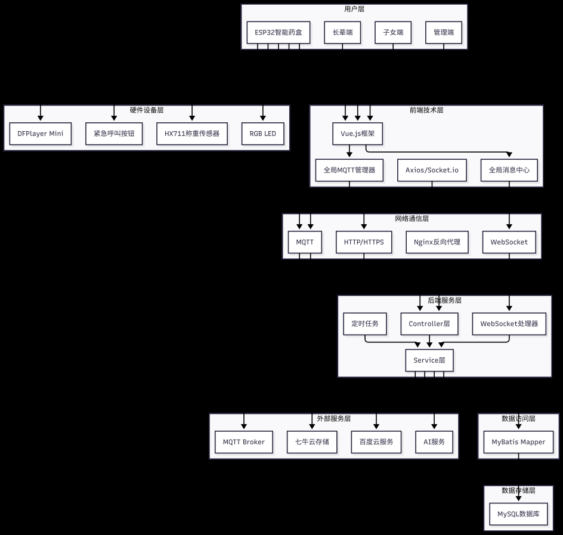
</p>

---

## 重要声明

- 本项目是**本科毕设级别**的个人作品，**前端与后端均由作者个人在 AI 辅助下完成**，代码主要用于学习与交流。
- **请勿将本项目（含代码、文档、界面）直接作为毕业设计或比赛作品提交**，也请勿用于任何形式的商业交付；如需参考，请务必在导师/赛事规则允许的范围内二次创作并注明出处。
- 项目中的健康分析、用药提醒、AI 建议等功能**不构成任何医疗建议**，真实用药请遵医嘱。
- 规模与工程化水平有限：未做压力测试与完整单元测试、前端仍是多页面 + CDN 引入、配置项较多。**欢迎提 Issue 一起优化，也欢迎轻拍。**

---

## 一、项目背景与系统架构

### 为什么做这个

我国 60 岁及以上人口占比已突破 19%，传统居家养老与机构养老都有明显短板：老人数字素养弱、养老服务智能化水平低、**老人—子女—社区三方协同链路断裂**。市面上多数同类产品只聚焦健康监测或用药提醒的单一模块，没有形成"监测 → 提醒 → 呼救 → 处置"的全流程闭环。

解尘颐安以**居家养老**为核心场景，围绕长辈、子女、社区管理员三类用户，覆盖**健康管理、用药监护、紧急求助、多方协同、信息互通**五大板块，做成"软件平台 + 嵌入式硬件"一体化的适老系统——ESP32 智能药盒负责"最后一步"的落地：药在盒里、提醒在耳边、数据在云端。

### 系统架构

<p align="center">
  <br>
  <sub>系统架构：终端（ESP32 药盒 / 子女端 / 管理端）→ 网络层（MQTT / HTTP / WebSocket）→ 业务层 → 存储层</sub>
</p>

<p align="center">
  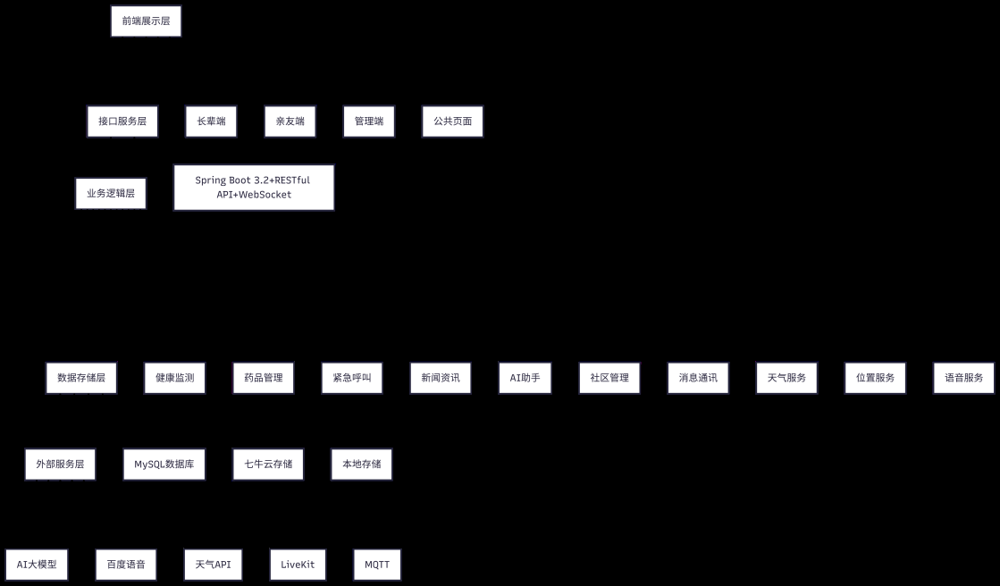<br>
  <sub>功能模块划分</sub>
</p>

<p align="center">
  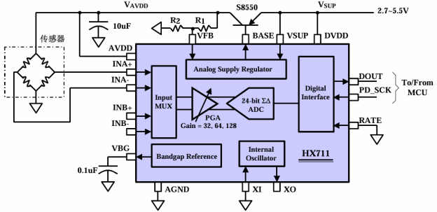<br>
  <sub>智能药盒硬件架构：ESP32 + HX711 称重 + RGB LED + 串口 MP3 语音模块 + 按键</sub>
</p>

### 数据库设计

<p align="center">
  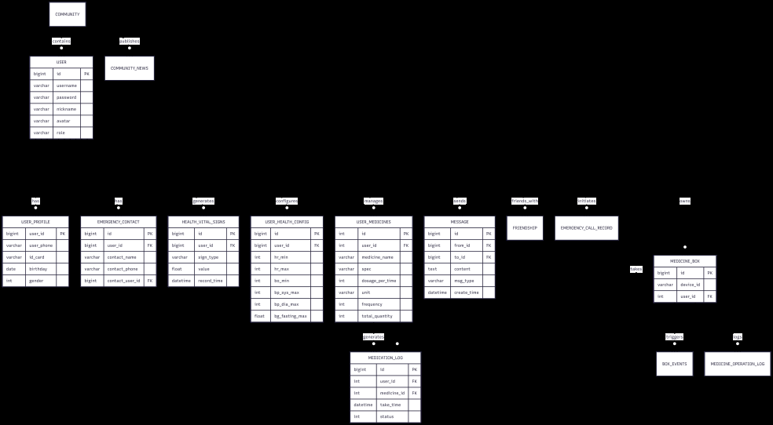<br>
  <sub>核心 ER 图（节选）：用户、健康体征、用药、紧急联系人、社交关系等</sub>
</p>

> 图源为项目设计文档导出，分辨率有限；完整表结构见 `docs/schema.sql`（待补）。

---

## 二、功能一览

### 核心功能模块

| 模块        | 说明                                                               |
| --------- | ---------------------------------------------------------------- |
| 健康监测      | 血压 / 心率 / 血氧 / 血糖 / 步数 / 睡眠数据记录与趋势分析，AI 生成健康报告与建议                |
| 用药管理      | 药品录入（支持 AI + OCR 识别药盒）、定时提醒、库存预警、用药记录追溯、**子女远程审核用药申请**（草稿/复核机制）  |
| 紧急呼叫      | 一键呼叫紧急联系人、健康异常自动报警、多联系人同时通知、实时位置共享与呼叫记录                          |
| 视频通话      | 基于 LiveKit 的视频/语音通话，配套实时聊天、语音消息、在线状态                             |
| 新闻资讯      | 兴趣偏好推荐、社区公告、**语音播报新闻**（百度 TTS）、AI 摘要与健康科普                        |
| AI 助手     | 语音/文字问答、天气查询、生活提醒、药品与健康咨询（大模型 + 工具调用）                            |
| 社交互动      | 好友管理、备注分组、在线状态、已读回执、消息归档                                         |
| 系统管理      | 用户与权限管理、社区/老人档案、数据看板、系统配置、操作日志                                   |
| 消息通知      | WebSocket 实时推送、系统通知、自定义铃声、浏览器通知                                  |
| 智能药盒（IoT） | ESP32 + 称重传感器 + LED + 语音模块，通过 MQTT 上报取药/重量变化，药品余量计算、错服/漏服提醒、家属通知 |

### 三种角色

- **长辈用户**：大字体/大按钮的简洁界面，健康上报、用药提醒、一键呼救、语音助手、看新闻、视频通话。
- **子女用户**：远程查看父母健康数据、审核用药申请、接收异常与呼救提醒、关联多位长辈。
- **社区管理员**：老人档案管理、健康数据统计、公告发布、紧急事件处理、系统配置。

### 界面预览

#### 长辈端

<p align="center">
  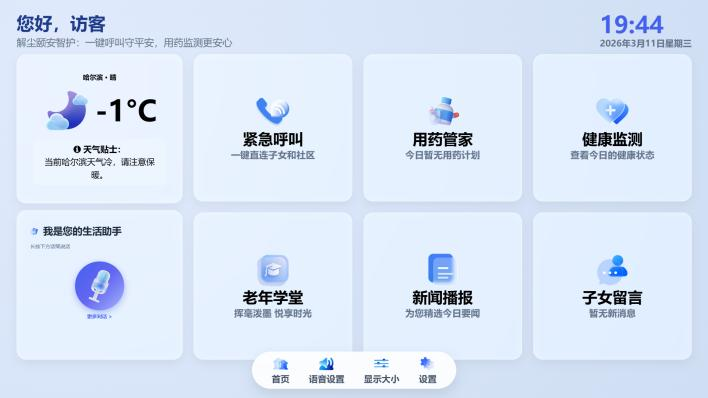<br>
  <sub>长辈端首页：大字体、高对比度，天气贴士 + 紧急呼叫 / 用药管家 / 健康监测快捷卡片 + 底部字体/语音快捷切换</sub>
</p>

<p align="center">
  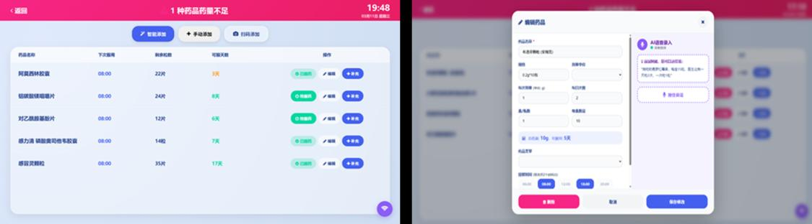<br>
  <sub>用药管家：药品列表、服用时间、剩余药量与可服用天数，顶部库存不足预警；药品信息修改自动同步子女审核</sub>
</p>

<p align="center">
  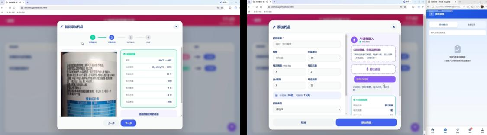<br>
  <sub>四种适老化录入方式：拍照 OCR 识别药盒、语音录入、扫码录入、手动录入</sub>
</p>

<p align="center">
  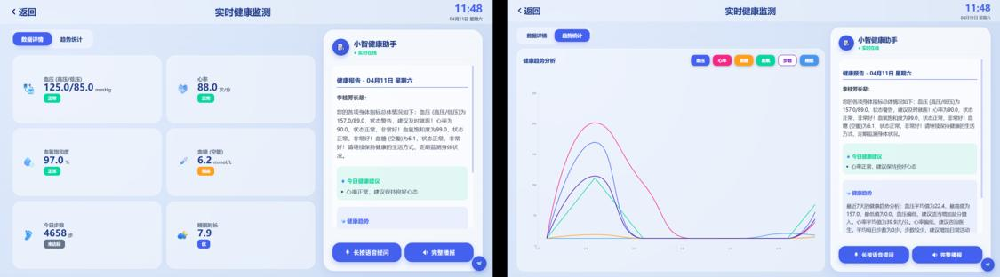<br>
  <sub>实时健康监测与近 7 日趋势图，AI 生成健康建议</sub>
</p>

<p align="center">
  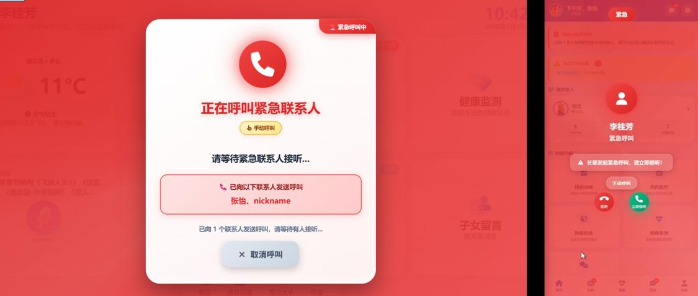<br>
  <sub>紧急呼叫：长辈端一键呼出，子女端实时接收弹窗提醒</sub>
</p>

<p align="center">
  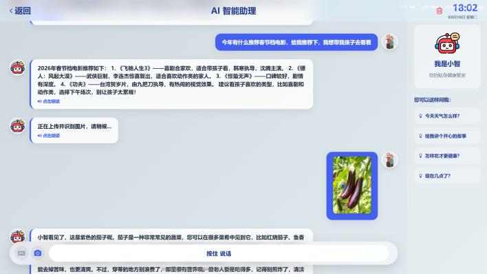<br>
  <sub>「小智」AI 助理：文字 / 语音 / 图片多模态问答</sub>
</p>

#### 子女端

<p align="center">
  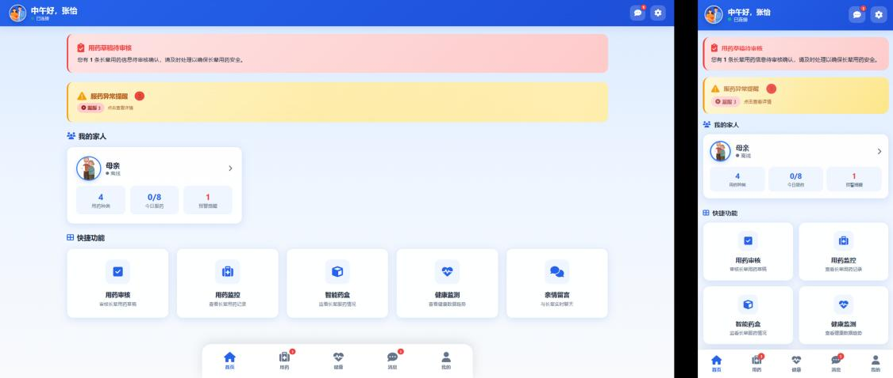<br>
  <sub>子女端首页（左 PC / 右移动端）：用药审核提醒、快捷功能直达、关联长辈状态一屏可见</sub>
</p>

<p align="center">
  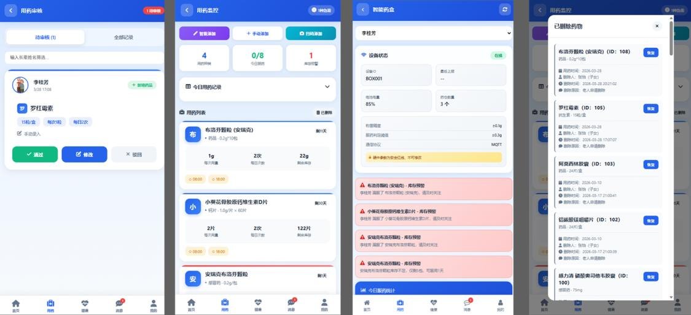<br>
  <sub>远程药物监控：药品审核 / 用药监控 / 智能药盒 / 用药记录，远程把关父母用药</sub>
</p>

#### 社区端

<p align="center">
  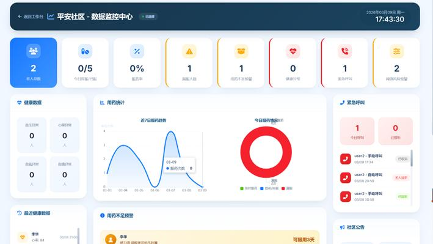<br>
  <sub>社区数据监控中心：住户、健康与告警数据统计看板</sub>
</p>

<p align="center">
  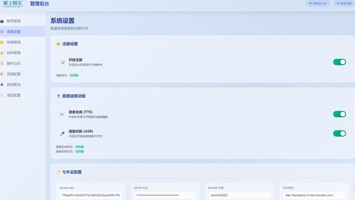<br>
  <sub>系统设置：注册开关、功能配置等全局参数管理</sub>
</p>

> 截图取自项目设计文档，分辨率有限；实际页面以部署后的效果为准。

---

## 三、核心技术与实测指标

几个自己觉得有点意思的技术点：

**1. 多模态药品录入**
老人手动打字录入药品几乎不可能。系统融合四条录入路径：AI 视觉 OCR（Qwen-VL 识别药盒上的名称/规格/用法用量）、ZXing 条码扫描匹配药品库、百度 ASR 语音描述 + 大模型信息提取、传统表单兜底，实测药品信息识别匹配度 95%+。

**2. 用药时间智能判断算法**
自定义"计划用药时间 / 用药间隔 / 补服窗口（间隔 1/2）/ 提前服药窗口（间隔 1/4）"四参数，按首末次用药划分 6 大场景，精准区分**正常服药、提前服药、补服、漏服、过早拦截**五种行为，并生成适老化口语化提示——既防漏服，也防过量。

**3. 紧急呼叫多端协同**
LiveKit 低延迟音视频 + Node.js 信令服务器实时监测联系人接听状态 + WebSocket 全端呼叫状态同步：长辈一键呼救 → 同时呼叫所有紧急联系人 → **首人接听后自动终止其余呼叫**。实测从触发到发起呼叫平均 3.2s。

**4. 健康数据实时采集与预警**
MQTT 承载穿戴设备/药盒的低功耗数据上报，Spring Scheduling 定时按**用户自定义阈值**判断异常，异常即通过 WebSocket 实时推送预警并通知紧急联系人，支持 BLE 蓝牙心率设备广播协议免配对采集。实测设备→系统平均延迟 1.8s。

**5. 适老化 AI 增强服务**
LangChain4j + Qwen 大模型，把用户健康数据与用药信息注入对话上下文，实现个性化健康咨询；新闻内容由大模型生成摘要（准确率 90%+、耗时 ≤3s）并支持语音播报；按阅读行为做适老化内容推荐。

**本地实测指标**（单机测试环境，仅供参考）：

| 指标 | 实测值 | 设计要求 |
| --- | --- | --- |
| 健康数据采集延迟 | 平均 1.8s | ≤ 3s |
| 紧急呼叫响应 | 平均 3.2s | ≤ 5s |
| 接口平均响应（500 并发在线） | 0.6s | ≤ 1s |
| 药品 OCR 信息匹配度 | 95%+ | — |
| 语音录入识别准确率（适老化测试） | 96% | — |
| 社区大屏数据刷新 | 5s/次 | 5s/次 |

---

## 四、技术栈

- **后端**：Java 21、Spring Boot 3.2.2、MyBatis / MyBatis-Plus、Druid、WebSocket、Spring Integration MQTT
- **前端**：原生 HTML/CSS/JS + Vue 3（CDN）、Font Awesome、ECharts、Socket.IO
- **数据**：MySQL 8.0
- **AI / 语音**：LangChain4j（OpenAI 兼容接口）、SiliconFlow / 火山方舟（豆包）、百度语音 TTS/ASR
- **实时通信**：LiveKit（音视频）、WebSocket（消息推送）、MQTT（设备）
- **存储**：本地 `./uploads` 或七牛云对象存储
- **硬件**：ESP32（Arduino 框架）、HX711 称重、RGB LED、串口 MP3 模块

---

## 五、目录结构

```
jcya/
├── pom.xml                          # Maven 依赖（Spring Boot 3.2.2 / Java 21）
├── docs/
│   ├── schema.sql                   # 数据库表结构（待补全）
│   ├── images/                      # 架构图 / 模块图 / ER 图 / 药盒硬件架构图
│   └── screenshots/                 # 三端界面截图
├── src/main/java/com/chat/older/xiechen/
│   ├── XiechenApplication.java      # 启动类
│   ├── config/                      # MVC、WebSocket、MQTT、LiveKit、AI 等配置
│   ├── controller/                  # 各业务接口
│   ├── service/                     # 业务逻辑（AI、用药、健康、MQTT、通知等）
│   ├── dao/ model/ vo/ common/      # 数据访问层、实体、视图对象、统一返回
├── src/main/resources/
│   ├── application-example.yml      # √ 配置模板（脱敏，可提交）
│   ├── mapper/                      # MyBatis XML
│   ├── static/                      # 前端页面（index / health / medicine / msg / call ...）
│   ├── sketch_mar11a/               # 智能药盒 Arduino 固件（已脱敏）
│   ├── server.js  package.json      # 早期 Socket.IO 信令服务（可选）
│   └── Dockerfile                   # 信令服务镜像（仅 Node 服务）
└── uploads/                         # 本地上传文件目录（运行时生成）
```

---

## 六、部署教程（从零跑起来）

### 1. 环境准备

| 组件          | 版本要求             | 备注                  |
| ----------- | ---------------- | ------------------- |
| JDK         | **21**           | 必须，项目按 21 编译        |
| Maven       | 3.6+             | 也可直接用 IDEA 内置 Maven |
| MySQL       | 5.7 / 8.0        | 建库字符集建议 `utf8mb4`   |
| Node.js     | 18+              | 可选，仅早期信令服务需要        |
| MQTT Broker | Mosquitto / EMQX | 可选，**玩智能药盒才需要**     |
| LiveKit     | 最新版              | 可选，**视频通话才需要**      |

### 2. 初始化数据库

```sql
CREATE DATABASE chat DEFAULT CHARACTER SET utf8mb4 COLLATE utf8mb4_general_ci;
```

> **关于建表脚本**：目前仓库里的 `docs/schema.sql` 是占位文件。如果你手上已有运行中的库，用下面的命令导出表结构放进去即可：
>
> ```bash
> mysqldump -uroot -p --no-data --skip-add-drop-table chat > docs/schema.sql
> ```
>
> 也欢迎你导出后提 PR 补上，方便其他人一键部署。项目启动时会自动初始化少量社区示例数据（`DdlApplicationRunnerConfig`）。

### 3. 配置文件

```bash
cp src/main/resources/application-example.yml src/main/resources/application.yml
```

然后按需修改 `application.yml`：

| 配置项                         | 必填 | 说明                                                               |
| --------------------------- | -- | ---------------------------------------------------------------- |
| `spring.datasource.druid.*` | √  | 数据库连接，库名默认 `chat`                                                |
| `server.port`               | √  | 默认 `7410`                                                        |
| `storage.use-local`         | √  | `true` 存本地 `./uploads`，`false` 走七牛云                              |
| `qiniu.*`                   | 选填 | 仅云存储模式需要                                                         |
| `ai-settings.api-key`       | 选填 | AI 助手、健康分析、药品 OCR 需要；不填则相关功能不可用                                  |
| `baidu.tts.*`               | 选填 | 语音播报需要                                                           |
| `doubao.api-key`            | 选填 | 新闻搜索增强                                                           |
| `mqtt.enabled`              | 选填 | 没有硬件时设为 `false`，否则启动会尝试连接 Broker                                 |
| `livekit.*`                 | 选填 | 视频通话需要，本地 `livekit-server --dev` 默认 `devkey` / `secret`，请与配置保持一致 |

> **密钥安全**：`application.yml`、`application-prod.yml`、`*.key`、`*.pem`、`*.crt` 已在 `.gitignore` 中排除，**请不要用 `git add -f` 强行提交**。若密钥曾经外泄，请到对应平台（七牛云 / SiliconFlow / 火山方舟 / 百度智能云）及时轮换。

### 4. 启动

```bash
# 方式一：直接跑
mvn spring-boot:run

# 方式二：打包后运行
mvn clean package -DskipTests
java -jar target/WebChat-1.0-SNAPSHOT.jar
```

也可用 IDEA 直接运行 `com.chat.older.xiechen.XiechenApplication`。

启动成功标志：控制台出现 `Started XiechenApplication ...`，并监听 `7410` 端口。

### 5. 访问

| 页面           | 地址                                             |
| ------------ | ---------------------------------------------- |
| 平台首页         | <http://localhost:7410/index.html>             |
| 登录 / 注册      | <http://localhost:7410/login.html>             |
| 关于我们         | <http://localhost:7410/about.html>             |
| 关于作者         | <http://localhost:7410/resume.html>            |
| 管理后台（God 模式） | <http://localhost:7410/xiechenGod.html>        |
| 智能药盒调试页      | <http://localhost:7410/medicine_box_test.html> |

首次使用请先注册账号（长辈 / 子女 / 管理员角色在注册与后台管理中区分）。

### 6. 可选组件

**MQTT（智能药盒）**

```bash
# Mosquitto 示例
mosquitto -p 1883 -v
```

设备侧烧录 `src/main/resources/sketch_mar11a/sketch_mar11a.ino`，**先改掉顶部 4 行**：`ssid` / `password` / `mqtt_server` / `device_id`；硬件接线见固件中的引脚定义（HX711、RGB LED、串口 MP3、按键）。

**LiveKit（视频通话）**

```bash
livekit-server --dev     # 默认 API Key: devkey, Secret: secret
```

把 `application.yml` 中 `livekit.api-key/api-secret` 改成与上一致。

**信令服务（可选，早期 WebRTC 方案）**

```bash
cd src/main/resources && npm install && node server.js
```

注意 `server.js` 读取 `/app/ssl/` 下的证书，本地调试需自行改成 HTTP 或自备证书。

### 7. 常见问题（FAQ）

- **启动报数据库连接失败**：检查 MySQL 是否启动、库名是否为 `chat`、账号密码是否正确。
- **端口被占用**：改 `server.port`，或结束占用 7410 的进程。
- **MQTT 一直重连**：没有硬件时把 `mqtt.enabled` 设为 `false`。
- **AI 助手没反应 / 新闻不摘要**：未配置 `ai-settings.api-key`，或余额/额度不足。
- **上传的图片打不开**：确认 `uploads/` 目录存在且可写，或检查 `storage.local.baseUrl` 与实际访问地址一致。
- **视频通话连不上**：确认 LiveKit 已启动且 key/secret 与配置一致。
- **验证码/登录异常**：项目使用 easy-captcha，需 JDK 字体环境正常（Linux 服务器无中文字体时可能报错）。

---

## 七、未来工作进展（Roadmap）

### 0. 端形态总览：三端 + 一个盒子

项目会从"Web 为主"走向"三端 + 硬件"，核心思路是：**老人能不碰手机就不碰手机**。

| 端       | 形态                            | 定位                       |
| ------- | ----------------------------- | ------------------------ |
| **老人端** | 智能药盒（主力入口）+ 老人 App / 小程序（极简版） | 药盒独立完成 80% 日常需求，App 只做补充 |
| **子女端** | 微信小程序 + App                   | 随时看一眼，随手审一下              |
| **社区端** | App + 小程序（后台仍是 PC Web）        | 移动办公、上门走访、工单闭环           |
| **物联层** | ESP32 智能药盒、各类传感器              | 数据采集 + 语音交互入口            |

---

### 近期重点一：嵌入式智能药盒的语音服务（AI 助手）

让药盒从"会亮的盒子"变成"会说话的陪护"：

1. **端侧唤醒 + 云端大脑**：ESP32-S3 接麦克风做唤醒词（如"小药同学"），唤醒后录音上传 → 云端 ASR → 大模型理解 → TTS 合成 → 药盒喇叭播报。项目里已有 `/api/esp32/asr`、`/api/esp32/chat`、`/api/esp32/tts` 的雏形，下一步是把链路跑通并压缩端到端延迟到 2 秒内。
2. **语音闭环确认服药**：播报"该吃降压药了，一次一片" → 老人回答"吃了" → 系统称重校验 → 记录用药日志；答"不舒服"/无应答则升级提醒子女。
3. **适老化语音交互**：慢速播报、音量自适应、方言与口音适配、药名/人名热词表，避免把"硝苯地平"听错。
4. **弱网与离线降级**：常用语句（吃药提醒、安慰语、天气）本地 MP3 缓存，断网也能提醒；网络恢复后补传记录。
5. **主动关怀**：久未取药、长时间无活动、喝水提醒、天气变化提醒，都由药盒主动开口。

#### 一个盒子顶八成功能：老人端"零手机"也能闭环

目标是不用手机、不看屏幕，仅靠药盒就能覆盖老人 80% 的日常需求（√ 表示断网也能用）：

| #  | 能力                                    | 形态        |
| -- | ------------------------------------- | --------- |
| 1  | √ 用药提醒：语音播报"该吃降压药了，一次一片" + 灯光提示 + 按键确认  | 定时 + 语音   |
| 2  | √ 服药打卡：拿起药品称重自动记录；说一句"吃了"也能确认           | 称重 / 语音   |
| 3  | 天气播报：早八点自动播报今日天气与穿衣建议（"今天零下五度，出门穿棉袄"） | 定时 + TTS  |
| 4  | 一键呼救：长按按键 → 轮播子女电话 + 平台告警 + 通知社区      | 按键        |
| 5  | 语音问答："今天几号""这药治啥的""我女儿几点来"            | ASR + 大模型 |
| 6  | 新闻 / 戏曲 / 收音点播：一句话点播，用嘴代替点击           | 语音 + 音频   |
| 7  | √ 久坐提醒、喝水提醒、整点报时、睡前提醒                   | 定时 + 语音   |
| 8  | √ 离线兜底：常用语本地 MP3 缓存，断网照样提醒，联网后补传日志      | 本地降级      |
| 9  | 亲情语音：子女在 App 录一段话，药盒到点播放（"爸，记得吃药"）    | 云端下发      |
| 10 | 异常上报：漏服、错服、余量不足 → 同步子女端与社区端           | MQTT 上报   |

### 近期重点二：三端应用（小程序 / App）

**老人端 App（极简版）**

- 首屏只有 3~5 个大按钮：吃药、呼叫家人、量血压、听新闻、找社区。
- 免注册 / 家属代注册，扫码或 NFC 贴一下即可绑定；支持语音输入代替打字。
- 只读式健康日历、用药打卡动画、一键视频呼叫（不用拨号、不用找人）。

**子女端 小程序 / App**

- 微信服务通知：用药异常、健康告警、一键呼救实时推送。
- 一屏看父母状态：今日吃药、血压趋势、步数、设备在线情况。
- 用药申请审核、药品代买、亲情语音录制并推送到药盒、多长辈切换与家庭共享。

**社区端 App / 小程序**

- 移动办公：老人档案查询、上门走访打卡拍照、工单派单与签收。
- 紧急事件接单与处置闭环；公告一键推送到老人药盒 / 音箱。
- 健康数据看板、异常名单、随访提醒、助餐助浴与代购预约统计。

### 适老化功能池（持续往里填）

按"老人真实卡在哪"来分类，后续版本逐条落地：

- **看得清**：字号三档可调（最大 28sp+）、高对比模式与黄底黑字、图标必配文字、长文本改短句、关键页面一屏一问。
- **听得清**：慢速 TTS、方言语音包、按环境噪声自动调音量、重要提醒重复播报两遍、支持助听器 / 蓝牙耳机。
- **点得动**：按钮热区 ≥ 60dp、滑动改点按、误触二次确认、连点防抖、关键操作可撤销、任何流程不超过 3 步。
- **叫得应**：语音唤醒"小药同学"、语音拨号（说"打电话给女儿"就拨）、一键 SOS 轮拨多位联系人、无人应答自动升级到社区 / 急救。
- **记得住**：语音备忘与定时提醒（"下午三点测血压"）、用药日历、家人语音留言墙、亲情相册自动轮播、每日一句问候。
- **被照护**：慢病随访计划、用药依从性评分、异常自动通知子女/社区、**子女远程协助**（代填药品、代约问诊）、远程医疗视频问诊预约。
- **生活与心理**：助餐 / 助浴 / 代购 / 陪诊预约、老年学堂与防诈提醒、公交与节日提醒、认知训练小游戏、志愿者陪伴排班。
- **更多终端**：电视端（遥控器就能用）、智能音箱端、蓝牙一键呼叫按钮、NFC 贴纸呼叫。

### 中期：硬件与数据能力

- 药盒升级为**多仓格**（舵机/步进电机分药）+ 多路 HX711 称重、低电量与开盖检测、离线数据补传。
- 接入**蓝牙血压计 / 血糖仪 / 手环**，自动生成 AI 健康周报与趋势预警。
- **安全看护**：毫米波雷达或 IMU 做跌倒/久坐/夜间离床检测，燃气、烟雾、门磁联动报警。
- **用药依从性评分**并在子女端可视化；药品 OCR 录入继续调优，支持处方与医保提醒。
- 社区侧：护工派单与工单流转、服务记录、药品代购与库存管理。

### 远期：工程化与生态

- 前后端分离（Vue3 工程化改造）、补 OpenAPI 接口文档、单元测试 + GitHub Actions CI。
- 小程序 / App 与后端共用一套接口，`uni-app` 之类跨端方案优先，避免三端重复造轮子。
- Docker Compose 一键起全套（MySQL + EMQX + LiveKit + 后端 + 前端）。
- 多社区/多租户、细粒度权限、数据加密与隐私合规（最小化采集、脱敏、审计日志）。
- 模块化拆分（IM / IoT / AI 各自独立），写清贡献指南，让项目能被真正共建。

> 说明：以上均为**规划中的方向**，按本科毕设级的精力排序推进，先保证"药盒能说话、三端能用起来"，再谈规模。

---

## 八、期望

- **对独居老人**：希望它真的"用得上、愿意用"——不追求炫技，而是少一次漏服、早一分钟被发现异常、多一句有人味的问候；更希望有一天，老人不用开手机、不用学操作，桌上的药盒就能把他照顾好。
- **对开发者/同学**：这是一个本科毕设级别的真实项目，希望它能作为适老化 + IoT + AI 结合的参考样例，给你一点点启发就很值。
- **对自己**：把嵌入式和 AI 从"跑通 demo"做到"稳定可用"，把代码写得更干净、更工程化，也把这件事坚持做下去。
- **对应用途的底线**：请勿直接拿去当毕设或比赛作品；想学习、想改进、想一起做，都欢迎，邮件聊。

---

## 九、关于作者

- 昵称：**望山遥**
- 邮箱：<yeechen177@163.com>

本项目前后端均由作者个人在 AI 辅助下完成，水平有限，欢迎交流与指正（页面入口：关于我们 → 关于作者）。

---

## License

代码以学习交流为目的开源，采用 [MIT License](LICENSE)。请保留作者署名，勿直接用于毕业设计或竞赛提交。
